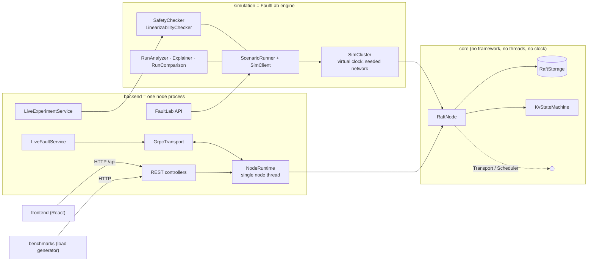
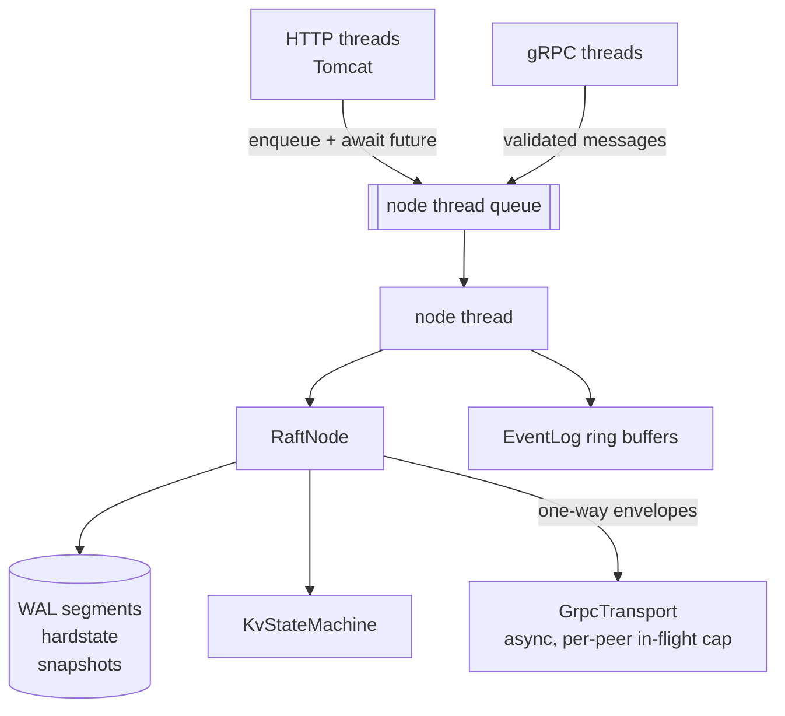
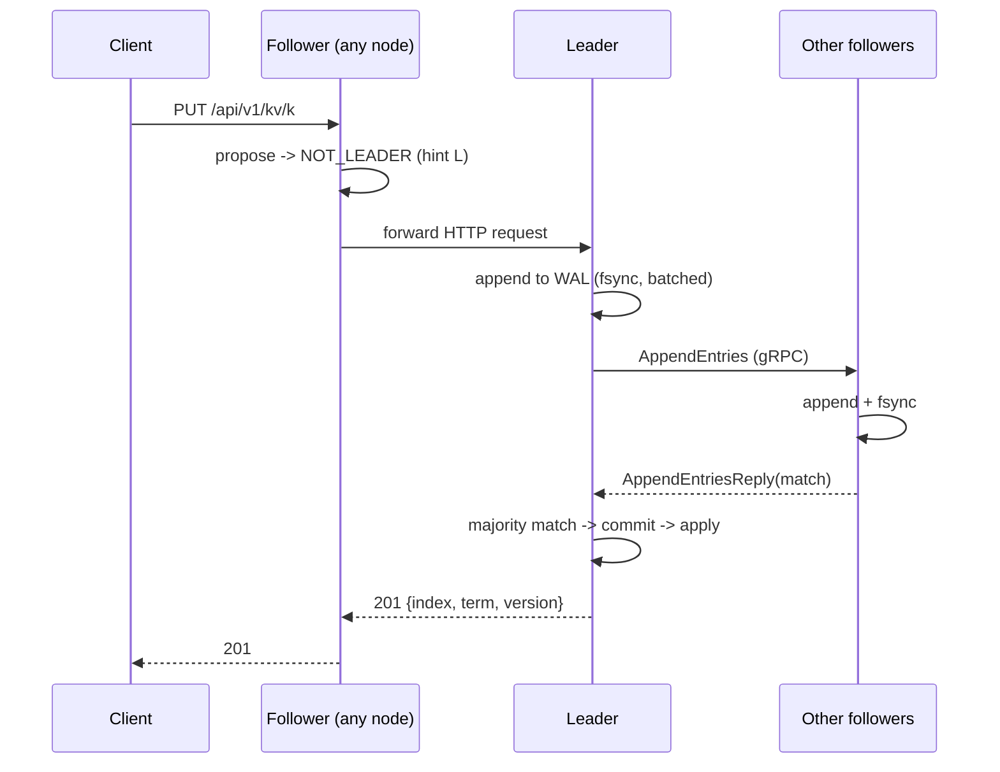
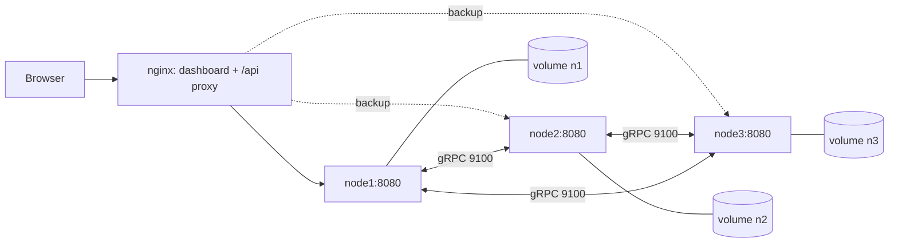

# Architecture

## Modules

| Module | Responsibility | Depends on |
|---|---|---|
| `core` | Raft (`RaftNode`), storage (`FileStorage`, `MemoryStorage`, `FaultyStorage`), KV state machine | nothing |
| `simulation` | Deterministic simulator, scenarios, safety and linearizability checkers, analysis | `core` |
| `backend` | Spring Boot node: gRPC transport, REST API, metrics, live faults and experiments | `core`, `simulation` |
| `benchmarks` | Closed-loop HTTP load generator | nothing (public API only) |
| `frontend` | Dashboard | REST API |

The key design decision is that **`RaftNode` has no hidden dependencies**: it talks to the world only
through four small interfaces (`Scheduler`, `Transport`, `RaftStorage`, `StateMachine`). The server plugs in
a real thread, gRPC and files; the simulator plugs in a virtual clock, a seeded network and in-memory disks.
There is one consensus implementation, and FaultLab tests exactly the code that runs in production mode.

## One node at runtime

- **One thread owns all Raft state** (`NodeRuntime`). HTTP and gRPC threads never touch it; they submit
  tasks and wait on futures. There are no locks inside the consensus code.
- **Group commit**: concurrent writes are queued and proposed as one batch per node-thread turn: one WAL
  append and one fsync for the whole batch.
- **Durability ordering**: `RaftStorage` methods return only after the data is durable, and Raft persists
  before it sends anything that depends on the write (votes, acknowledgements).
- **Fail-stop**: any storage error stops the Raft node rather than continuing on state it cannot trust.

## Write path

A write is **committed** when a majority stores it (and it is from the leader's term), **applied** when the
leader executes it on its state machine, and **acknowledged** only after both. See
[CONSISTENCY_MODEL.md](CONSISTENCY_MODEL.md).

## Deployment

`docker-compose.yml` runs three nodes with persistent volumes, the dashboard behind nginx, and an
optional Prometheus (`--profile metrics`). `scripts/cluster.sh` does the same with plain processes.

## Concurrency assumptions (summary)

| Component | Threads | Shared state protection |
|---|---|---|
| `RaftNode`, `KvStateMachine`, `FileStorage` | node thread only | none needed |
| `EventLog`, `OperationLog`, `RequestMetrics` | any | `synchronized` |
| `NetworkFaults` | any | concurrent collections, volatile fields |
| `GrpcTransport` stats | gRPC + node thread | atomics |
| `LiveFaultService` | HTTP threads + expiry thread | `synchronized` apply/revert |
| Simulator | exactly one thread | none (determinism depends on it) |
