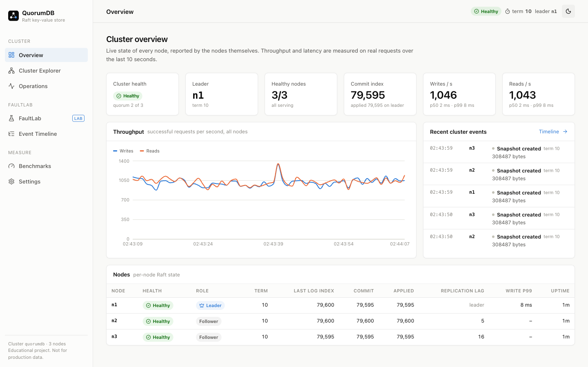
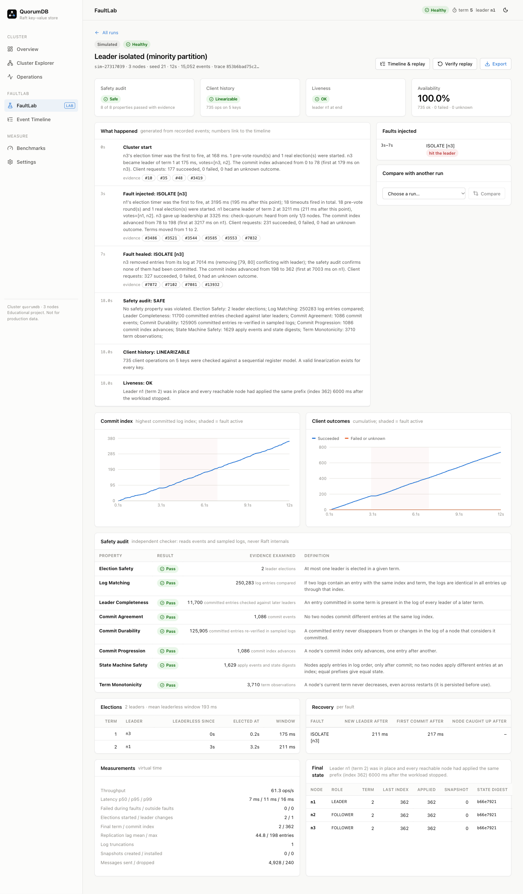
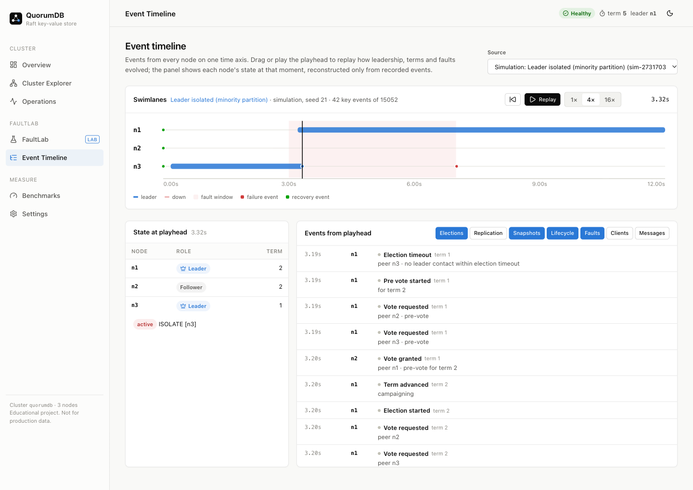

# QuorumDB

A distributed, fault-tolerant key-value database built on a from-scratch implementation of the
[Raft](https://raft.github.io/raft.pdf) consensus algorithm in Java 21, with **FaultLab**: an integrated
environment for injecting failures (in a deterministic simulator or on the real cluster) and having an
independent checker decide, with evidence, whether the database kept its guarantees.

> QuorumDB is an educational and experimental project. It is not a replacement for etcd, PostgreSQL or any
> production database, and nothing here claims production readiness. Known limitations are listed below
> and in [FAILURE_MODES.md](FAILURE_MODES.md).



*The dashboard on the Docker deployment under a 50/50 load (real requests). Throughput inside the Docker VM
is not comparable with the benchmarks below: fsync there is much cheaper than on the host.*

## What is implemented

| Area | What exists | Where it is verified |
|---|---|---|
| Raft core | Leader election, PreVote, CheckQuorum, log replication with fast backtracking, current-term commit rule (Figure 8), snapshots + InstallSnapshot (one in flight per follower), ReadIndex reads, fail-stop on disk errors | 46 unit tests, 25,000- and 10,000-scenario soaks, property tests |
| Storage | Segmented CRC32C write-ahead log, atomic hard-state and snapshot files, torn-write recovery, corruption detection | 22 storage tests including crash/corruption cases |
| State machine | PUT / GET / DELETE / existence / atomic batch / prefix scan, versioned compare-and-set, idempotent retries | 9 tests |
| Cluster | One node per process, Raft over gRPC, REST API with leader forwarding, group commit, 3 read consistency levels, Prometheus metrics | 9 real-process integration tests (SIGKILL, partitions, restarts, live audits, resource limits) |
| FaultLab | Deterministic simulator running the same `RaftNode` class, 13 scenarios, live fault injection, audited live experiments, safety + linearizability checkers, evidence-linked explanations, replay, comparison, heap-derived limits on simulated runs | 72 tests incl. seeded-bug tests that the checker must catch |
| Dashboard | React + TypeScript: overview, cluster explorer, operations console, FaultLab, event timeline with replay, benchmarks, settings; light + dark theme | 16 Vitest tests; screenshots in [docs/screenshots](docs/screenshots) |
| Benchmarks | Closed-loop load generator, 1/3/5-node matrix, read consistency levels, fault runs, before/after snapshot experiment | [docs/evidence/benchmarks.md](docs/evidence/benchmarks.md), [BENCHMARKS.md](BENCHMARKS.md#snapshot-storm-investigation) |
| Deployment | Docker Compose: 3 nodes on fixed addresses + dashboard (nginx) + optional Prometheus | `scripts/verify_docker.py`, also in CI; [docs/evidence/docker.md](docs/evidence/docker.md) |

Latest full run (2026-11-14): `./gradlew test :backend:integrationTest`, **171 tests, all passed**. The count
includes parameterized and property-based (jqwik) cases, so it is larger than the number of `@Test` methods; frontend
`npm test`, **16 passed**. Exact counts per suite: [docs/evidence/test-summary.md](docs/evidence/test-summary.md).

## Quick start

Requirements: JDK 21, Node 20+ (dashboard), optionally Docker.

```bash
# 1. Three real nodes as local processes (HTTP 8081-8083, Raft/gRPC 9101-9103)
scripts/cluster.sh start 3

# 2. Use it
curl -X PUT localhost:8082/api/v1/kv/greeting -H 'Content-Type: application/json' -d '{"value":"hello"}'
curl localhost:8083/api/v1/kv/greeting                       # linearizable read (default)
curl 'localhost:8083/api/v1/kv/greeting?consistency=stale'   # local, possibly stale read
curl localhost:8081/api/v1/cluster

# 3. Dashboard (dev server proxies to the local cluster)
cd frontend && npm ci && npm run dev    # http://localhost:5173

# 4. Kill the leader for real and watch a new one take over
scripts/cluster.sh kill n1 && sleep 1 && curl localhost:8082/api/v1/leader
scripts/cluster.sh revive n1

scripts/cluster.sh stop        # or: clean (also deletes data)
```

With Docker (three nodes on 8081-8083 + dashboard on <http://localhost:3000>):

```bash
export QUORUMDB_ADMIN_TOKEN=$(openssl rand -hex 24)   # optional: enables live fault injection
docker compose up --build -d                          # first build takes ~3 minutes
python3 scripts/verify_docker.py                      # optional: election, replication, failover,
                                                      # recovery, fault cleanup, persistence checks
docker compose down        # keeps data volumes;  down -v deletes them
```

Paste the same token into the dashboard's Settings page to use live FaultLab and fault injection.
If `docker compose` is not available, the standalone `docker-compose` binary works the same way
(`python3 scripts/verify_docker.py --compose docker-compose`). Verified results:
[docs/evidence/docker.md](docs/evidence/docker.md).

A single node: `java -jar backend/build/libs/quorumdb-server.jar` after `./gradlew :backend:bootJar`.

## REST API

| Method and path | Purpose |
|---|---|
| `PUT /api/v1/kv/{key}` | Write `{"value": "...", "expectedVersion": n?}`. 201 created, 200 updated, 409 version mismatch. Acknowledged only after a majority commit. |
| `GET /api/v1/kv/{key}?consistency=linearizable\|leader\|stale` | Read. 404 if absent. `HEAD` checks existence. |
| `DELETE /api/v1/kv/{key}` | 200 deleted, 404 did not exist (the delete still committed). |
| `POST /api/v1/batch` | Atomic multi-key `{"ops":[{"op":"PUT","key":"a","value":"1"}, ...]}`. |
| `GET /api/v1/kv?prefix=&limit=` | Ordered prefix scan. |
| `GET /api/v1/health` · `/node` · `/nodes` · `/cluster` · `/leader` | Node and cluster state. |
| `GET /api/v1/metrics` · `/cluster/metrics` · `/metrics/prometheus` | Throughput, latency percentiles, Prometheus format. |
| `GET /api/v1/events` · `/cluster/events` · `/operations` · `/config` | History and configuration. |
| `POST/DELETE/GET /api/v1/faults` | Live fault injection (admin token). |
| `/api/v1/faultlab/...` | Scenarios, simulated runs, replay, compare, export, live experiments. |

Idempotent retries: send `X-Client-Id` and `X-Request-Seq`; the same pair is never applied twice. Errors use
one shape: `{"error": "NO_LEADER", "message": "...", "node": "n2", "leaderHint": "n1"}`. Exact guarantees:
[CONSISTENCY_MODEL.md](CONSISTENCY_MODEL.md).

## FaultLab



Pick or write a scenario (faults, timing, workload, Raft settings), run it, and get:

- a **safety audit** of eight Raft properties, each with the amount of evidence examined,
- a **linearizability** verdict on everything the clients observed,
- a **liveness** verdict kept separate from safety (losing a quorum is *expected unavailability*, not a bug),
- an **explanation** generated from recorded events, every claim linked to the events it rests on,
- **replay**: the same scenario and seed reproduce the identical event trace (SHA-256 verified),
- **comparison** of any two runs, and the same pipeline on the **live cluster**.



Details: [FAULTLAB.md](FAULTLAB.md). How it relates to Jepsen, Maelstrom, FoundationDB and TigerBeetle:
[docs/PRIOR_ART.md](docs/PRIOR_ART.md).

## Measured performance (one laptop, all processes local)

From [docs/evidence/benchmarks.md](docs/evidence/benchmarks.md) (Apple M5, fsync on every write):

| Cluster | 1 client | 64 clients | p50 / p99 at 64 clients |
|---|---:|---:|---:|
| 1 node | 242 writes/s | 7,874 writes/s | 8.0 / 14.7 ms |
| 3 nodes | 97 writes/s | 2,870 writes/s | 21.9 / 36.7 ms |
| 5 nodes | 96 writes/s | 2,126 writes/s | 29.7 / 46.5 ms |

Linearizable reads on 3 nodes: 31,175/s (p50 0.96 ms). SIGKILL of the leader under load: 300 ms without a
successful write (100 ms resolution). A raw fsync costs 3.8 ms on this machine, which dominates write
latency; see [BENCHMARKS.md](BENCHMARKS.md) for methodology and caveats.

## Documentation

[ARCHITECTURE.md](ARCHITECTURE.md) · [RAFT_DESIGN.md](RAFT_DESIGN.md) · [CONSISTENCY_MODEL.md](CONSISTENCY_MODEL.md) ·
[FAULTLAB.md](FAULTLAB.md) · [FAILURE_MODES.md](FAILURE_MODES.md) · [TESTING.md](TESTING.md) ·
[BENCHMARKS.md](BENCHMARKS.md) · [CONTRIBUTING.md](CONTRIBUTING.md) · [CHANGELOG.md](CHANGELOG.md) ·
[docs/PRIOR_ART.md](docs/PRIOR_ART.md) · [docs/PROGRESS.md](docs/PROGRESS.md) ·
[docs/HANDOVER.md](docs/HANDOVER.md)

## Known limitations

- **Fixed membership.** No joint consensus or single-server membership changes.
- **No TLS or authentication on the Raft and client ports**; the admin token only guards fault injection. Run on a private network.
- **Storage runs on the Raft thread.** fsync blocks the node thread, so reads queue behind writes under mixed load (see the mixed-workload benchmark).
- **Whole-state snapshots in memory.** InstallSnapshot is sent in chunks of at most 4 MB, one chunk in flight per
  follower, but both sides still hold the whole snapshot in memory (fine for MB-scale data, not GB). A lost chunk
  restarts that follower's transfer from the beginning after an election timeout.
- **Durability depends on fsync.** On macOS `FileChannel.force` is `fsync`, not `F_FULLFSYNC`; power-loss durability is weaker there than on Linux.
- **Live FaultLab** orders events from different nodes by their local clocks: accurate on one host, approximate across hosts. Live runs cannot be replayed exactly.
- FaultLab's checkers find violations in what they observe; passing runs are evidence, not proof of correctness.
- **Snapshots compact the log right up to the applied index**, so a follower only a few entries behind receives
  the whole snapshot (one 300 KB message per follower per snapshot in the benchmarks) instead of a few entries.
- **Simulated FaultLab runs need no token.** They are bounded by heap-derived limits (422 `RUN_TOO_LARGE`), but
  any client can keep the simulation slots busy; keep the API on a private network.
- **Live FaultLab reports** count the time before the run's first observed election as leaderless (see
  [FAULTLAB.md](FAULTLAB.md#live-experiments)); verdicts are not affected.

## License

MIT, see [LICENSE](LICENSE).
